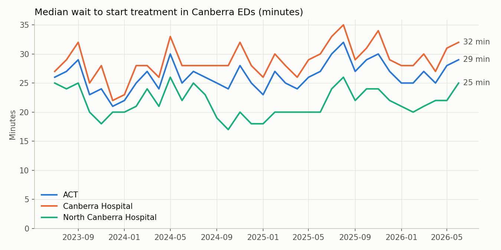
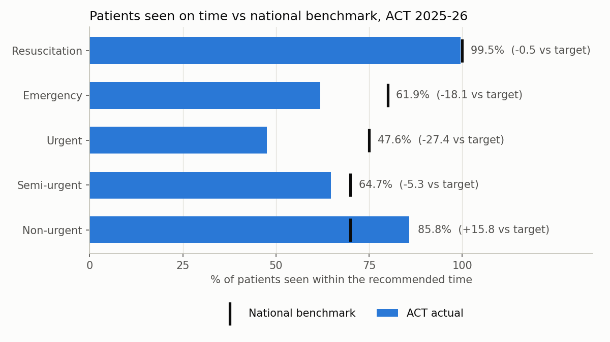
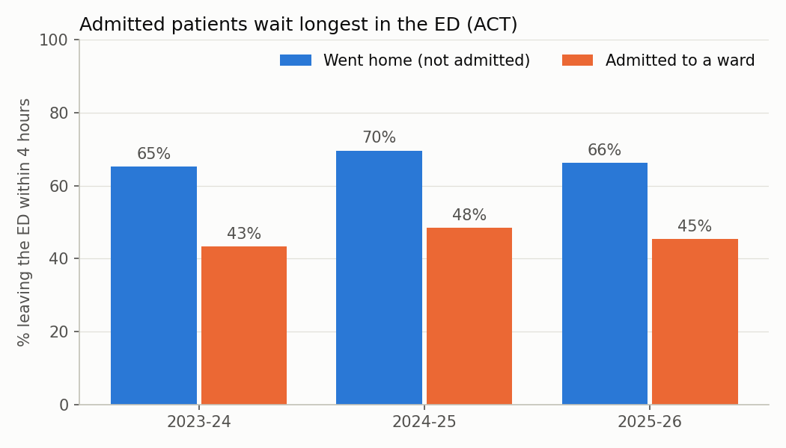

# Canberra Emergency Department Wait Times: A SQL Analysis

**Question:** How long do patients wait in Canberra's public hospital emergency
departments, where is the system falling short, and is it getting better?

**Tools:** SQL (SQLite) · Python (pandas, matplotlib)
**Data:** [ACT public hospital emergency department performance data](https://www.data.act.gov.au/Health/ACT-public-hospital-emergency-department-performan/s8sb-gu5s/about_data),
ACT Government Open Data Portal. 3,347 monthly records, July 2023 – June 2026,
covering Canberra Hospital, North Canberra Hospital and the ACT as a whole.

📄 **[Read the 4-page report (PDF)](report/Canberra_ED_Wait_Times_Report.pdf)**

---

## Key findings

**1. Performance got worse in 2025-26.** It was the weakest of the three years:
the median wait to start treatment rose to **28 minutes** (from 25 in 2023-24), and
only **58.6%** of patients were seen within the recommended time (down from 62.0%).

| Financial year | Median wait (min) | % seen on time | % left ED within 4 hrs |
|---|---|---|---|
| 2023-24 | 25 | 62.0 | 56.2 |
| 2024-25 | 26 | 61.6 | 60.6 |
| 2025-26 | 28 | 58.6 | 57.7 |



**2. "Urgent" patients are the biggest gap.** Category 3 (Urgent) patients should be
seen within 30 minutes, with a national benchmark of 75%. In 2025-26 only
**47.6%** were, 27 percentage points short. Neither hospital met the Urgent
benchmark in **any of the 36 months** on record. Only Non-urgent patients met
their benchmark.



**3. Canberra Hospital is under more pressure than North Canberra Hospital.**
In 2025-26 its median wait was 30 minutes versus 23, and 55.0% of patients were
seen on time versus 64.4%.

**4. Patients who need a hospital bed get stuck in the ED.** Only **45%** of
patients admitted to a ward left the ED within 4 hours, compared with **66%** of
patients who went home. That gap suggests the delay is partly about bed
availability in the wider hospital, not just ED staffing.



**5. Winter is the worst time.** August and July have the longest average median
waits (about 28 minutes); January has the shortest (about 23 minutes).

### What this could mean for policy
- Effort aimed at **Urgent (Category 3)** patients would close the largest gap.
- Measures that free up ward beds (discharge planning, step-down care) could
  help ED flow as much as extra ED capacity.
- Winter surge planning should start before July.

*These are observations from aggregate monthly data. They show where to look,
not the causes.*

---

## Database design

The raw CSV is loaded unchanged into a staging table, then cleaned with SQL into
a star schema:

```
hospitals ──┐
measures ───┼──< ed_performance  (one row per hospital × measure × triage × month)
triage_categories ┘
```

- `triage_categories` adds the national **Australasian Triage Scale** targets
  (e.g. Emergency = seen within 10 minutes, 80% benchmark), so actual performance
  can be compared with the benchmark in a single JOIN.
- Text months such as `Jul 2023` are converted to real dates (`2023-07-01`).
- Blank values become `NULL`, not `0`, so averages aren't distorted.
- A view, `v_ed`, joins everything together for easy querying.

## SQL skills demonstrated

| Query | Question | Skills |
|---|---|---|
| Q1 | Year-by-year overview | Conditional aggregation (pivot), date filters |
| Q2 | Hospital comparison | Subqueries, calculated columns |
| Q3 | Triage vs benchmark | JOINs to lookup tables, `CASE` |
| Q4 | Months meeting benchmark | `GROUP BY`, `SUM(CASE …)` counting |
| Q5 | Worst 3 months per year | CTE, `RANK() OVER (PARTITION BY …)` |
| Q6 | Rolling 12-month trend | `AVG() OVER` sliding window, `LAG()` |
| Q7 | Seasonality | Date functions, grouping on derived columns |
| Q8 | Admitted vs not admitted | Pivot, `IN` filters |
| Q9 | Data-quality check | `HAVING`, `COUNT(*)` vs `COUNT(col)` |

All queries are in [`sql/03_analysis.sql`](sql/03_analysis.sql); results are in
[`results/`](results/).

## Data quality notes
Query Q9 found two gaps, both for **North Canberra Hospital, Resuscitation**:
- 4-hour measure, admitted patients: December 2024 is missing entirely.
- 4-hour measure, not admitted: December 2024 is present but blank.

Resuscitation numbers are very small each month, so its percentages move a lot.
ACT Health also notes that some figures may be affected by data-capture issues
after its digital health record system was introduced.

## How to run it

```bash
python build_database.py   # creates data/act_ed.db from the raw CSV
python run_analysis.py     # runs all queries, saves results/ and charts/
```

You need Python 3 with `pandas` and `matplotlib` (both included in Anaconda).
SQLite comes built into Python.

## Project structure

```
data/raw/act_ed_performance.csv   original download (unchanged)
sql/01_schema.sql                 table definitions
sql/02_transform.sql              cleaning: staging -> final tables
sql/03_analysis.sql               the 9 analysis queries
sql/04_practice.sql               extra questions to try yourself
build_database.py                 loads the CSV and runs 01 + 02
run_analysis.py                   runs 03, saves results and charts
report/                           4-page summary report (PDF)
```
